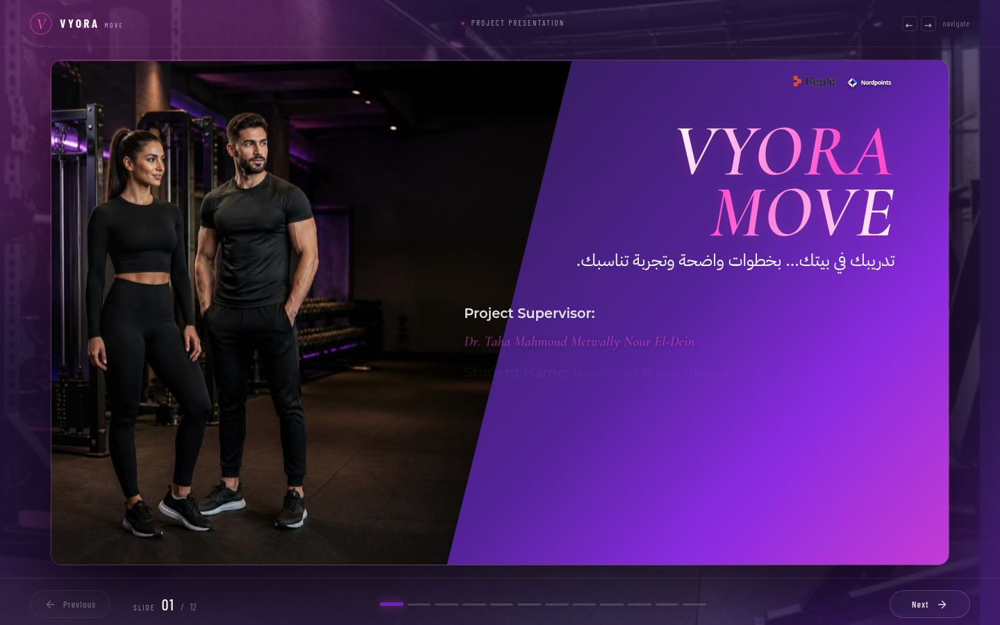
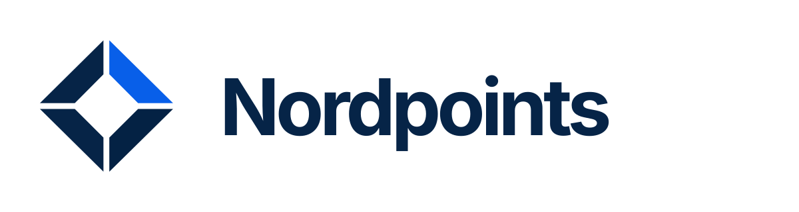

# VYORA MOVE — العرض التفاعلي الجديد

  

  <a href="https://tmrynk-tdrybt-lbyt.replit.app/"><strong>فتح تطبيق VYORA MOVE</strong></a>
  · <a href="https://tmrynk-tdrybt-lbyt.replit.app/vyora-interactive-deck/"><strong>فتح العرض التفاعلي</strong></a>
  · <a href="deliverables/VYORA-MOVE-Project-Presentation.pdf">فتح العرض PDF</a>
  · <a href="deliverables/VYORA-MOVE-Project-Presentation.pptx">تحميل PowerPoint</a>
  · <a href="artifacts/vyora-interactive-deck/src/pages/slides/">ملفات الشرائح</a>
  · <a href="artifacts/vyora-interactive-deck/src/App.tsx">مشغّل العرض</a>

العرض التفاعلي يتكون من 12 شريحة. تظهر معاينة الغلاف هنا، ويمكن فتح ملف PDF أو PowerPoint لمشاهدة العرض، أو مراجعة ملفات الشرائح والكود.

  
  

**Vibe Coding — تطبيق عملي ضمن منحة Nordpoints لتعلّم Vibe Coding**

الموقع الرسمي: [Nordpoints.com](https://nordpoints.com/)

## VYORA MOVE — العرض التفاعلي الجديد

تطبيق ويب عربي للياقة المنزلية، مع تجربة تناسب البنات والولاد وتساعد على تنظيم التمارين ومتابعة التقدم.

**Created by: Donia Nabil Mesaad Ghoneim**

**Project Supervisor:** Dr. Taha Mahmoud Metwally Nour El-Dein

## ملفات المشروع

- [فكرة المشروع](PROJECT_IDEA.md)
- [كود العرض التفاعلي الجديد](artifacts/vyora-interactive-deck/)
- [تطبيق VYORA MOVE](artifacts/home-workout/)
- [الخادم وواجهات التطبيق](artifacts/api-server/)
